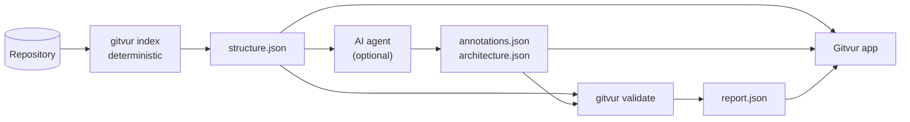

# Gitvur

**See any repository as a living map: modules → files → classes → functions, with
descriptions you can trust.**

Gitvur is a local, open-source (MIT), **read-only** desktop app. It extracts a
repository's structure with tree-sitter, lets an AI coding agent add meaning
(modules, descriptions, flows, an architecture diagram), and validates every claim
the agent makes against the real code. When the code changes, Gitvur shows exactly
which descriptions have gone stale.


- **Works offline.** No network, no telemetry, no AI runtime inside the app.
- **Never runs your code.** Repositories are read as data only.
- **Languages:** Python, TypeScript, C and Go. Plus any Markdown docs in the repository.

## What you can do with it

### Explore the map and inspect any element

Click a module, file, class or function to see its description, source code,
imports, calls and callers. AI-claimed relationships are dashed, and show the
exact lines they're based on.


### Know what to trust

The **Documentation** lens colours every element as documented, stale or
undocumented, and a banner tells you when the code changed since the map was
built.


### Follow execution flows

The **Flows** tab plays a request or command step by step across modules.
**Trace** mode shows the call tree computed purely from code, with no AI.


### Read the architecture at a glance

The **Diagram** tab shows the system's major components and how they interact,
as written by the documenting agent and checked by the validator.


### Read the docs next to the code

The **Docs** tab renders the repository's Markdown safely, including Mermaid
diagrams. Code mentions link back to the map.


### Compare two revisions

The **Changes** lens shows what was added, modified, moved or removed between
two commits, with inline or side-by-side diffs.


## How it works



**Structure is extracted deterministically. Meaning is written by an AI agent.
Everything the agent writes is validated.** All output lives in a `.gitvur/`
folder inside the analysed repository.

Read [How Gitvur works](docs/HOW_IT_WORKS.md) for the full set of diagrams:
pipeline, data files, staleness, the documentation loop and the code layout.

## Quick start

You need Rust (the version pinned in `rust-toolchain.toml` installs itself through
rustup), Node.js 22+, pnpm, and the
[Tauri 2 prerequisites](https://v2.tauri.app/start/prerequisites/) for your OS.

```bash
git clone https://github.com/ibrahimAlsalimi/gitvur.git
cd gitvur

# 1. Build the CLI
cargo build --release -p gitvur-cli

# 2. Index any repository (writes only <repo>/.gitvur/)
./target/release/gitvur index    /path/to/your/repo
./target/release/gitvur validate /path/to/your/repo

# 3. Launch the desktop app and open that repository
cd app
pnpm install
pnpm tauri dev
```

**Just want to look around?** Run `pnpm dev:mock` in `app/` and open the printed
URL in a browser. It loads the bundled demo repositories, so you don't need Tauri
or your own repository.

The [step-by-step setup guide](docs/USING_GITVUR.md) covers each step in detail,
including system packages, the optional AI documentation pass, and keeping the map
current.

## Command line

| Command | What it does |
| --- | --- |
| `gitvur index <repo>` | Extract structure into `.gitvur/structure.json` |
| `gitvur validate <repo>` | Check structure and annotations; write `.gitvur/report.json` |
| `gitvur stale <repo>` | List stale and undocumented element IDs |
| `gitvur packet <repo> --mode initial\|incremental` | Write the AI agent's work list |
| `gitvur diff <repo> <revA> <revB>` | Compare the structure of two revisions |
| `gitvur flows <repo>` | List entry points and curated flows with their status |
| `gitvur trace <repo> <id>` | Print a bounded call tree from an entry point or function |

## Keyboard shortcuts

| Keys | Action |
| --- | --- |
| `Ctrl/Cmd+1 / 2 / 3 / 4` | Map / Docs / Flows / Diagram |
| `Ctrl/Cmd+K` | Search everything |
| `Ctrl/Cmd+O` | Open a repository |
| `1 2 3` | Structure / Documentation / Changes lens |
| `J / K`, `Space` | Step through or play a flow |
| `T` | Switch between Flow and Trace |
| `?` | Show all shortcuts |

## Project status

Gitvur is a working prototype. The plan is in
[`PROTOTYPE_V2_PLAN.md`](PROTOTYPE_V2_PLAN.md), and the session-by-session log is
in [`PROGRESS.md`](PROGRESS.md). Next up: a Git timeline view (Phase 17).

## Development

```bash
# Rust
cargo fmt --all --check
cargo clippy --workspace --all-targets -- -D warnings
cargo test --workspace

# App (from app/)
pnpm typecheck && pnpm lint && pnpm test
pnpm e2e            # Playwright, light and dark themes
```

Contributor and agent rules are in [`CLAUDE.md`](CLAUDE.md).

## License

[MIT](LICENSE)
