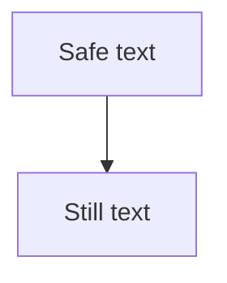

# Untrusted document

<iframe src="https://tracker.invalid/frame"></iframe>

[Unsafe script](<javascript:alert(1)>)
[Unsafe data](data:text/html,attack)
[Unsafe file](file:///etc/passwd)
[Unsafe encoded](<java%73cript:alert(1)>)

