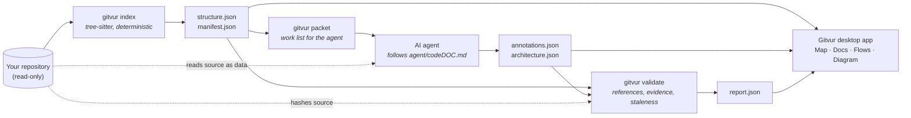
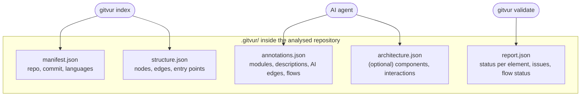
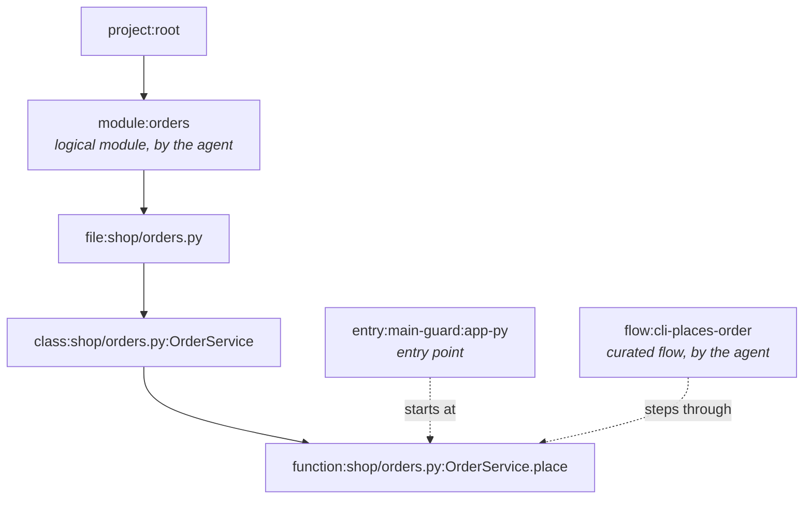
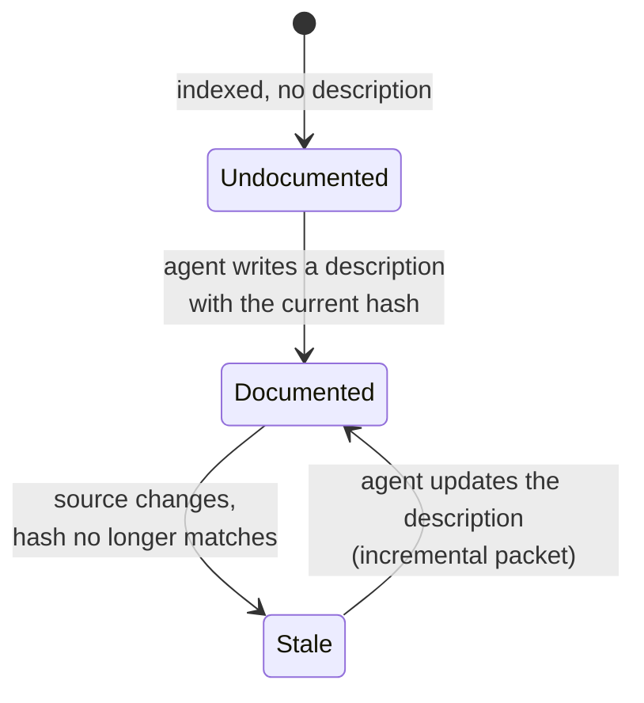
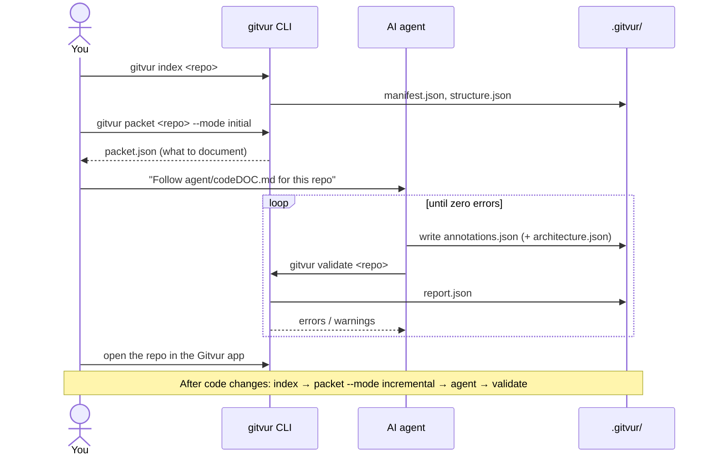
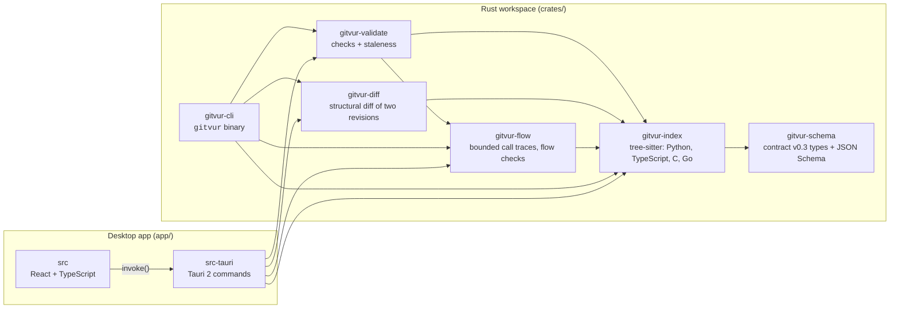
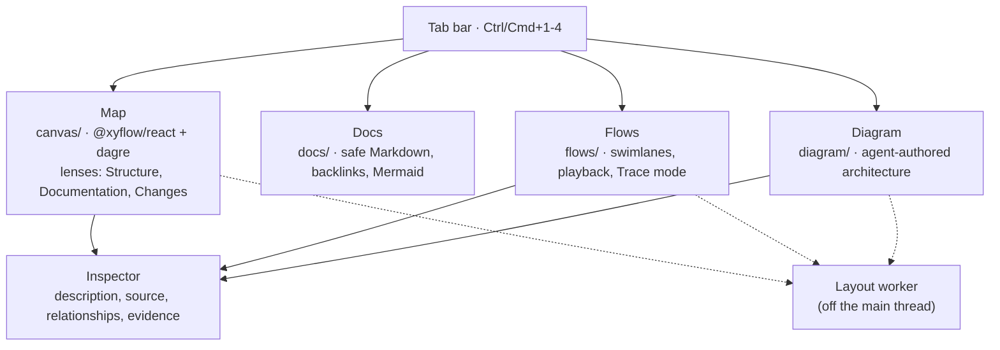

# How Gitvur works

This page explains Gitvur's moving parts with diagrams. For installation and a
step-by-step walkthrough, see the [setup guide](USING_GITVUR.md).

The diagrams use Mermaid, which GitHub renders directly. In Gitvur's own **Docs**
tab, they render as images too.

## The core idea

> **Structure is extracted deterministically. Meaning is written by an AI agent.
> Everything the agent writes is validated.**

Gitvur keeps two kinds of knowledge apart:

| Layer | Written by | Contains | Can it be wrong? |
| --- | --- | --- | --- |
| **Structure** | `gitvur index` (Rust + tree-sitter) | Files, classes, functions, line ranges, content hashes, imports, calls, entry points | Same input → byte-identical output. No AI, no network |
| **Meaning** | An AI coding agent you run yourself | Logical modules, descriptions, hidden relationships, curated flows, architecture map | Yes, so every claim must point at real code and is checked by the validator |

The desktop app merges both layers and always shows where each fact came from.

## The pipeline

Every step except the AI agent is deterministic and offline. The agent step is
optional: without it, you still get a full structural map, call traces and
revision diffs.

## What lives in `.gitvur/`

Each file has exactly one writer. Nothing else in your repository is modified.

## The node hierarchy

Every element has a stable, readable ID. The agent may only describe IDs the
indexer produced; it can't invent nodes.

Relationships (edges) carry a **provenance**:

| Provenance | Meaning | Drawn as |
| --- | --- | --- |
| `syntactic` | Found by the indexer in the code (an import, a call with exactly one target) | Solid grey line |
| `semantic` | Reserved for deeper, type-aware analysis; the current indexer doesn't emit it | Solid blue line |
| `ai` | Claimed by the agent; must cite a file and line as evidence | Dashed purple line with an **AI** pill |

If a call has two or more possible targets, the indexer records it as
*ambiguous* rather than guessing. If it has no target inside the repository, it
is dropped.

## How staleness is detected

Each node in `structure.json` has a `contentHash` of its source. When the agent
describes a node, it copies that hash into the annotation. On every validation,
Gitvur compares the two.

If an element is deleted or renamed, its old description points at an ID that no
longer exists. The validator reports that as a `dangling-ref` error, so the agent
must remove or move it.

Curated flows have their own status: **current**, **stale** (a step's code
changed) or **broken** (a step no longer exists, or the evidence is wrong).

## The documentation loop

Gitvur never calls an AI model itself. You run a coding agent (Claude Code, Codex
or similar) on an isolated copy of the repository, and Gitvur checks its work.

Incremental mode lists only stale and undocumented elements, so unrelated
descriptions, modules and architecture components are preserved.

## Inside the code base

The frontend talks to the backend only through a small set of Tauri commands:

| Group | Commands |
| --- | --- |
| Repository | `open_repository`, `index_repository`, `validate_repository`, `recent_repositories`, `forget_recent` |
| Source | `read_source`, `read_revision_source`, `list_commits`, `diff_revisions` |
| Docs | `list_docs`, `read_doc`, `read_doc_asset` |
| Flows | `get_trace` |
| Export | `write_export` (save dialog only; refuses paths inside the repository) |
| App state | `get_settings`, `set_settings`, `get_view_state`, `set_view_state`, `clear_view_state` |

The UI is organised by tab:

## Safety guarantees

- **Never runs your code.** Repositories are read as data: no builds, installs, test
  runners or scripts.
- **Read-only viewer.** The app writes only to `.gitvur/`, and only when you click
  **Index** or **Validate**. Exports go through a save dialog to a folder outside
  the repository.
- **Path safety.** Every path read from `.gitvur/` is resolved against the
  repository root and rejected if it escapes it, including through symlinks.
- **Safe Markdown.** Raw HTML is never rendered. Remote images need a per-document
  opt-in, and external links ask for confirmation.
- **Local only.** No network calls, no telemetry, no AI runtime inside Gitvur.

## Learn more

- [Setup guide](USING_GITVUR.md): installation, indexing, the app and the AI pass.
- [Agent instructions](../agent/codeDOC.md): what the documenting agent must follow.
- [Data contract](../crates/gitvur-schema/README.md): IDs, fields and versions.
- [Indexer rules](../crates/gitvur-index/README.md): per-language resolution rules.
- [Validator rules](../crates/gitvur-validate/README.md): every check and issue code.
