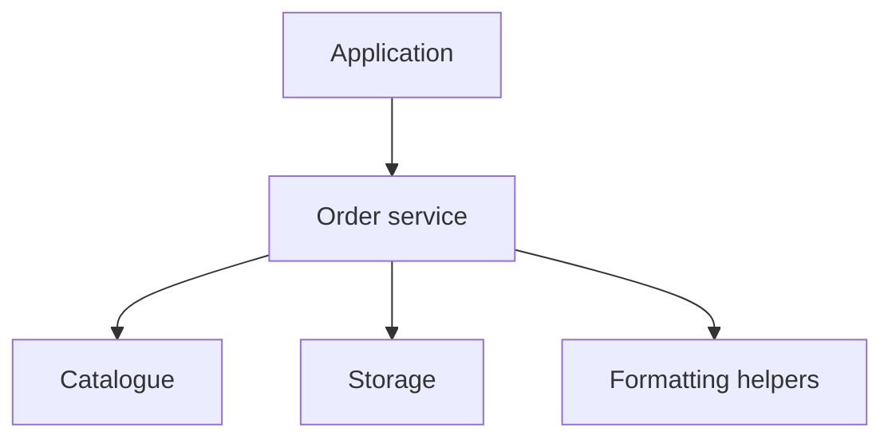

# Shop architecture

The example separates order processing, catalogue objects and storage.

## Order processing

`OrderService.receipt` formats a receipt using shared helpers. [Read the implementation](../shop/orders.py#L23-L26) or return to the [README](../README.md#getting-oriented).



### Responsibilities

| Part | Purpose |
| --- | --- |
| Catalogue | Books and toys |
| Orders | Purchasing and receipts |
| Storage | Cache and persisted items |

## Storage

`shop/store.py` writes items to disk. `Store.save` serialises the stored items.

```python
def save(item):
    return item
```

> Follow a code mention to inspect its source and relationships on the map.

- [x] Keep responsibilities separate
- [ ] Explore [the shop folder](../shop/)


